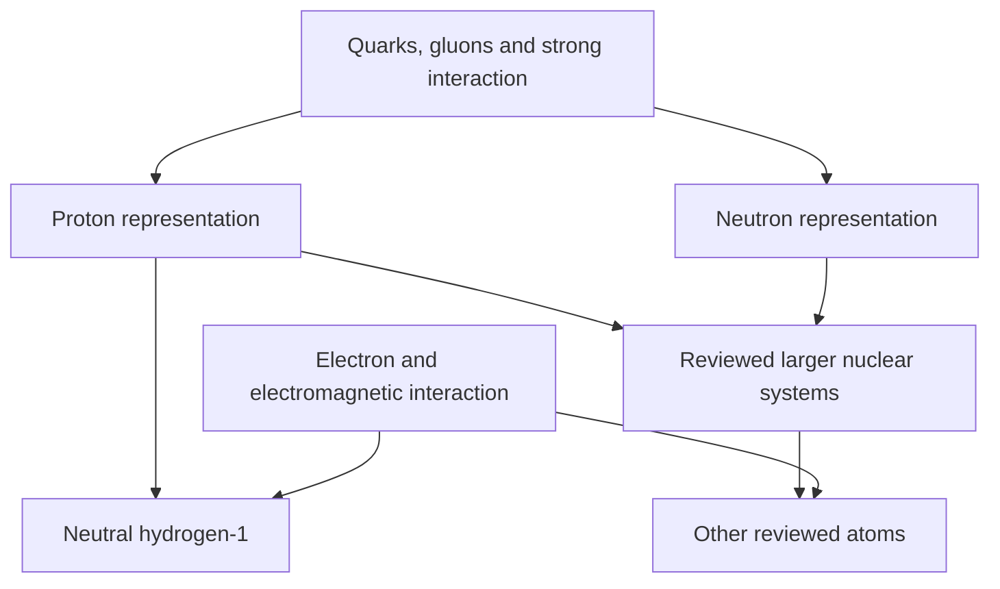
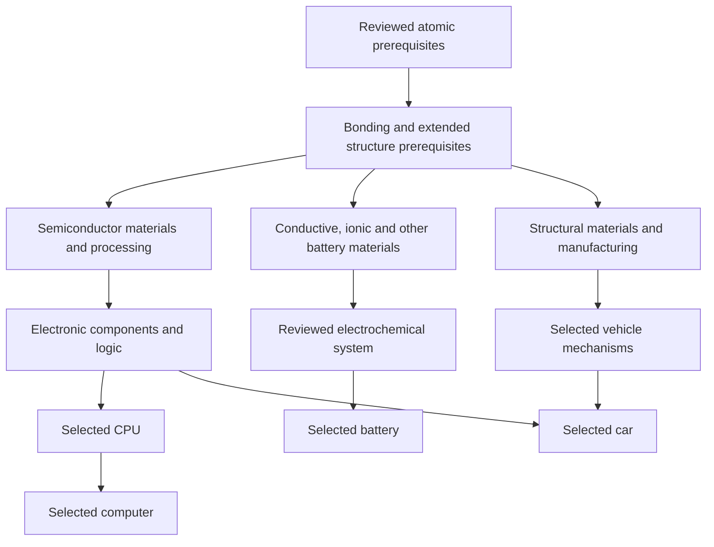

# Machines Constituent Construction — Initial Dependency Map

Status: authoring artifact, not an executable Course or a complete science map.
Direction accepted in [0008](../../docs/decisions/0008-constructive-foundation-and-shared-branches.md).
All arrows below denote prerequisites of the proposed educational construction,
not a chronological timeline, physical reaction or industrial manufacturing recipe.
Multiple incoming arrows are cumulative prerequisites, not alternative inputs.

## First bounded construction

Quarks/electrons are experimentally elementary within current evidence; particle
and interaction representations must expose that boundary. Quantum fields
provide the supported descriptive foundation. Do not depict particles as
unexplained solid spheres containing invented smaller pieces. A field is not a
known physical substance assembled from a smaller inventory.

A proton's two up and one down valence quarks identify its composition but are
not its whole structure. Gluon/sea dynamics and the role of interactions must
remain explicit in the selected simplified model. A neutron has one up and two
down valence quarks. A free neutron is unstable: that branch cannot silently
promise another indefinitely stable free component. Exact nucleus formation and
stability are authored separately. Hydrogen-1 needs a proton and an electron;
it contains zero neutrons. Deuterium and tritium are other hydrogen isotopes
with one and two neutrons respectively. Its bound state is not a fixed planetary orbit. No physically isolated-quark
creation or unconstrained assembly recipe is selected.

## Later branches — scope placeholders requiring research

This schematic deliberately does not declare every dependency. A computer needs
more than its CPU; a car's systems depend on the selected propulsion variant.
Battery composition and chemistry must be selected. Other atom types cannot be
created merely by adding neutrons or electrons to hydrogen; their nuclear
prerequisites and supported formation processes require their own construction.
Biological and other functional systems can branch from the appropriate shared
foundation, with exact paths researched rather than inferred from this diagram.

## Reuse and advancement

A completed core process becomes available for later reviewed compositions.
Its quantity is simplified; its structure and provenance remain inspectable.
Shared progress belongs to that versioned construction/process, not a duplicate
copy inside each destination. A branch may advance only when all required
prerequisites are available and its committed state is valid. View changes and
invalid transient attempts do not complete processes. Replay is voluntary.

Evidence must distinguish valid assembly, observed traversal and demonstrated
reasoning. First-slice acceptance needs a meaningful learner-controlled state
change, visible causal behavior, pause/inspection, valid persistence and clear
representation limits. No game-engine replacement or completed prototype is
claimed by this authoring artifact. A separate authorized
[Constituents Lab candidate](../../Prototypes/MachinesMouseThree/Experiments/Constituents/README.md)
now implements the first proton/hydrogen/neutron composition paths. It does not
implement the later material or destination branches, reaction dynamics or a
canonical Course. Its tests and device evidence are separate from this map.

## Primary scientific references

- [CERN: Subatomic particles](https://home.cern/science/physics/subatomic-particles/).
- [CERN: Particles and fields](https://home.web.cern.ch/science/physics/higgs-boson/what/).
- [DOE: Quarks and gluons](https://www.energy.gov/science/doe-explainsquarks-and-gluons).
- [DOE: Protons](https://www.energy.gov/science/doe-explainsprotons).

- [DOE: Deuterium and tritium](https://www.energy.gov/science/doe-explainsdeuterium-tritium-fusion-fuel)
  (rechecked 2026-10-15): hydrogen-1 has no neutron; other hydrogen isotopes do.
